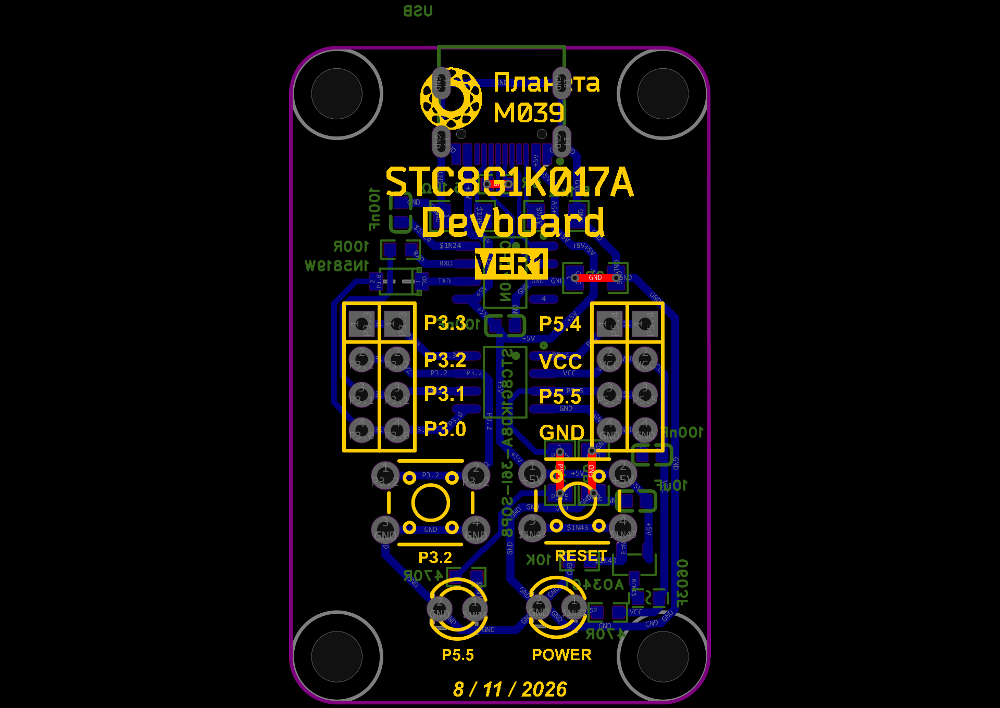
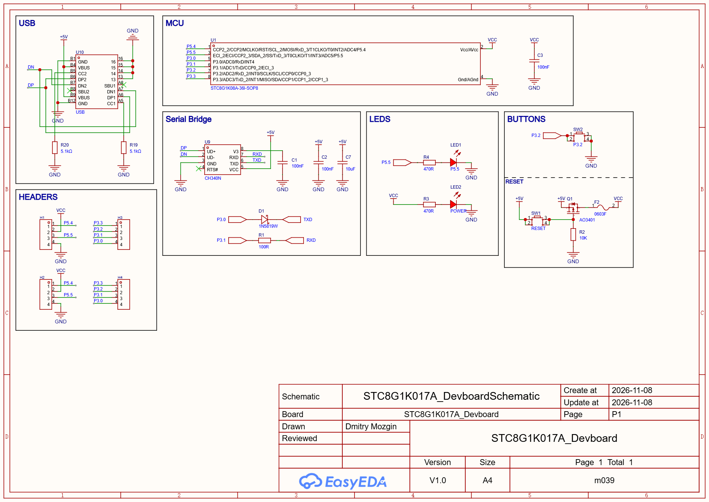

# PCB — STC8G1K017A_Devboard

Дизайн печатной платы отладочного модуля **STC8G1K017A** (`STC8G1K017A_Devboard/STC8G1K017A_Devboard.eprj2`).

## Печатная плата (PCB layout)

## Схема (Schematic P1)

---

*Комментарии к коду и этот README составлены Qwen 3.8.*