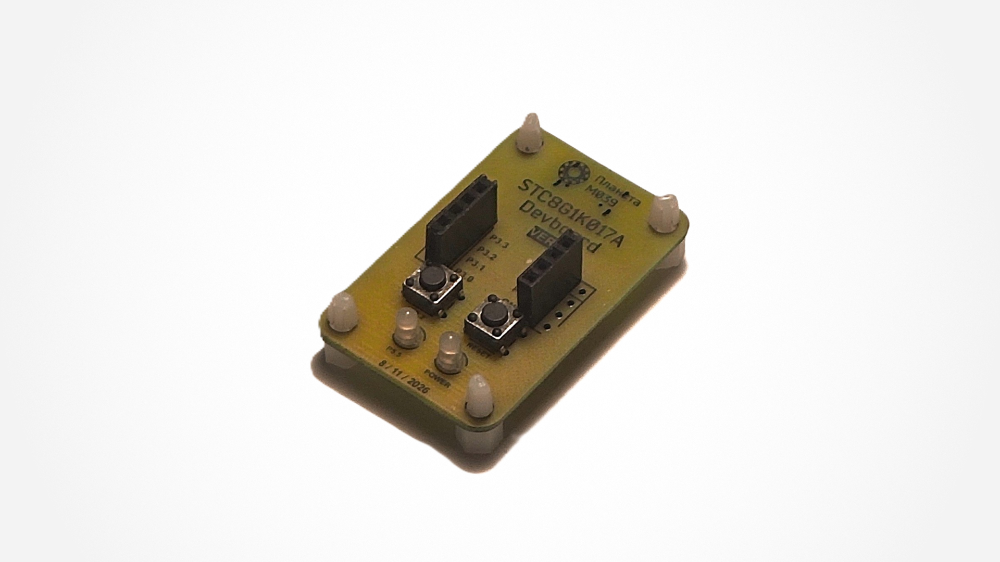

# stc-playground

> **Сноска**: этот проект — эксперимент по использованию **Qwen 3.8 27B**: код, комментарии и README.md написаны ИИ, но проверены человеком; печатная плата разведена и произведена также человеком.

Песочница для изучения микроконтроллеров **STC8**. На данный момент есть одно такое устройство — плата **STC8G1K017A_Devboard**: её проект и схема лежат в [`PCB/`](./PCB). Весь код из папки [`Code/`](./Code) написан для него.

## Проекты

| Проект | Описание |
| :----- | :------- |
| [blink](./Code/blink) | Базовое мигание светодиода: P5.5, симметричный цикл (горит 1 с → гаснет 1 с) |
| [blink-asm](./Code/blink-asm) | То же мигание, но чистым SDCC-ассемблером (`sdas8051`), без C и FwLib_STC8 |
| [button](./Code/button) | Кнопка на P3.2 (INT0): реакция сразу в ISR; при удержании — быстрое мигание, при отпускании — медленное |
| [button-pwm](./Code/button-pwm) | Плавное свечение яркости: ШИМ PCA2 на P5.5 (~43 кГц); при удержании кнопки (P3.2) цикл идёт быстрее |

---

*Комментарии к коду и этот README составлены Qwen 3.8.*
